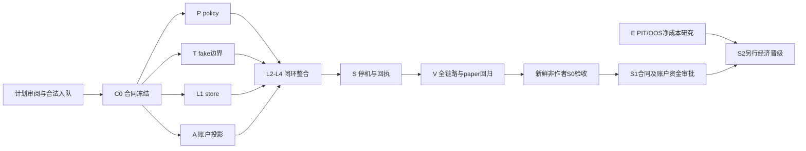

# Polymarket 上线准备 Implementation Plan

> **For agentic workers:** REQUIRED SUB-SKILL: Use superpowers:subagent-driven-development. 用户已选定多 Agent 协作；按下列任务逐项实施，checkbox（`- [ ]`）仅记录未来执行。先读批准的 SPEC 与本计划，当前不实施产品代码。

**Goal:** 完成隔离的 S0 订单闭环、真实账户语义与经济证据验收，为另行获准的有限 S1 通道测试提供可审候选。

**Architecture:** 保留现有 paper runner、账本与 guard；新增独立 execution 模块，纯 policy → 原子 reserve/持久命令 → 单次 transport → 外部事件投影 → 独立对账 → 回执。S0 只有内存 fake；真实适配器及 S1 操作在官方合同、项目边界、账户和资金授权通过后另审。拟用标准库 SQLite 保存唯一跨 run 事件账；这是本份新计划提交审阅的物理存储选择。

**Tech Stack:** Python 标准库 Decimal/json/hashlib/sqlite3/typing，复用项目 StateLock 模式和既有 pytest；S0 无新第三方依赖、SDK、网络或后台服务。

**Spec:** [已批准执行设计](../launch-profit-prep-20261025/02-execution-design/SPEC.md)、[X01–X16 验收](../launch-profit-prep-20261025/02-execution-design/ACCEPTANCE.md)、[总案](../launch-profit-prep-20261025/LAUNCH_AND_PROFIT_PREPARATION.md)。上游包 SHA256 `078b152de683738a14d686e437ebdb769945d334b15293471188db30998fffdd`。旧文档的待审状态是封存时历史；本轮批准证据记在 `00-control/START.json`，不覆写历史。

## Global Constraints

- `mode=paper`, `live_enabled=false`, `require_human_gate=true`；既有 1%/3%/$1000 paper 参数不是实盘授权。
- 本次为 `PLAN_READY_FOR_REVIEW / NOT_IMPLEMENTED / NOT_RUNTIME_ACTIVE / CHANNEL_TEST_NOT_AUTHORIZED`。交易保持关闭；不承诺上线日、收益或安全试验金额。
- 正式仓库 `D:/projects/polymarket-pod` 本轮 READ_ONLY，root 只执行过获准 fetch；仅写本仓库外计划目录。不读 `.env`、密钥、账户；不安装 SDK、不运行应用/测试/runner/调度器，不领取/修改队列，不提交/push/合并。
- 未来工程必须从当时 `origin/dev` 独立 worktree 开始，遵守一轮只做队列第一件 todo、base=dev PR、不开第二件、不自合并。并行准备/QC不能变成同时领取多件任务；当前 EG/PR360 不接管。
- 真实资金、累计损失上限、次数、有效期、资格/托管、费用、协议/finality/可用账户范围仍 UNKNOWN。任何必需 UNKNOWN 阻止新增风险，不能填零放行。
- 保留旧 paper 文件/接口/pins/guard/历史；不把 paper fill、请求 ACK、halt、查不到或回执 hash 升级为真实成交/已撤/资金到账/盈利/权限。
- 金额用明确资产/链/单位的规范十进制字符串；bool 不作 int，非有限值/坏时间/额外字段/重复 JSON 键拒绝。无自动补腿/重发/赎回/转账/扩仓/账户切换。

## Review Focus

RF1 — Submission uncertainty and crash/restart: durable reserve and command precede transport; SUBMITTING recovery is UNKNOWN with no blind resend.

RF2 — Cancel/late-fill/stop races: request is not confirmation, reserve survives unknown remainder, and authorized observe/cancel survives stop-new-orders.

RF3 — Account scope, collateral, fees and cross-run reserve overlap: complete external truth, disjoint reserve accounting, one bound store across run_id, no fresh-DB budget reset.

RF4 — Protocol/schema/time/approval boundaries: exact asset/domain/units, strict finite types and hashes, freshness/expiry; UNKNOWN required inputs deny new risk.

RF5 — Recursive execution boundary, exports and economic evidence: no S0 SDK/network/credentials; secret-safe mode-explicit receipts, no paper/synthetic fill or missing cost promoted to real profit.

---

## 阅读与实施权威

本主计划 + [C0 合同与任务](00-control/C0_CONTRACT_TASK.md) + [整合决定](00-control/C0_SCHEMA_DECISIONS.md) 是执行权威；组件封存计划提供精确 TDD 步骤/命令/证据，按下表逐项修订解释，不修改其历史字节。涉及签名/字段的冲突以 C0 为准，以下 overrides 不可忽略。未定义的 S0 接口不得由各作者自行猜测；真正官方 API/SDK/账户 UNKNOWN 则是 S1 取证停止关卡。

| 封存 intake 定位 | 本计划决定与验收 |
|---|---|
| L `STORE_LIFECYCLE_PLAN.md:96,156,189,220` 长时间 owner lock / 私有 `_controller_lock` | 采用 `ExecutionStore.controller_lock(self) -> ContextManager[None]` 公共 API；仅短暂持有以提交 claim/状态，**网络调用前释放**。submit/cancel 分别有持久 claim；SQLite 事务也不跨网络。新增 L 测试 `test_blocked_submit_does_not_block_stop_or_scoped_cancel`：用内存 Event 卡住 submit，另一线程/进程 STOP_SET 和另一已知获权订单 cancel 均完成且没有第二次 submit；停止先于 claim 则零提交，claim 先于停止则承认在途不确定。
| L `:50,59,63–64,68–77` 旧事件名/字段/wrapper；S `:46,50–62` 未决合同 | 采用 C0 全部事件、receipt union、`__store__`、reserve_context 和返回字段；明确 `state_sha256` 是 journal head hash，版本连续，replay 校验派生索引。UNSENT_REJECTED/冲突事件/ACCOUNT_RECONCILED 使释放与HOLD可表达；无任意现金setter、无 STOP_CLEAR。
| P `POLICY_PLAN.md:124,129,144,152` 旧字段/现金二次扣除 | policy 的自由现金唯一为 `cash_available`，已经扣 external+local additional；禁止再减 local_uncovered_reserve/external_unmapped_freeze。未知映射直接 HOLD。`test_free_cash_counts_only_uncovered_reserve_once` 改为 total10、external0.5、local0.51、overlap0.5→available9.49；C=9.49允许、9.491拒绝，外部available9.5不误当可花9.5。风险类别不重复计 fee；各 approval 和全账户 cap 分别检查。
| P/T/A 的 account、source、chain、hash 和 minimum 字段提案 | 采用 C0 单一 AccountSnapshot/Asset/现金命名；CommandState.accounting_summary由L+A依真实去重事件原子派生并随snapshot提供给pure回执，不能拿限价/最大预算冒充实际成本。intent_sha256由原封存意图证据提供，UNKNOWN保留，不拿ID或proposal哈希改名。chain_id 为 exact int；`minimum_unit=money|shares|UNKNOWN` 显式区分订单最小额和最小股数，不按旧例假定。所有原始外部 JSON 用 decode_record，dict validator 不声称能识别已丢失的重复键。
| T 与 V 的 fake/fixture/测试写权 | 唯一 `tests/fake_transport.py` + 根 `tests/conftest.py::fake_transport_factory`，归 T。V 不重新创建这些 fake 或覆盖 P/L/A/S 自有测试；V只独占集成/原生故障补充测试，其他用例由相应作者写，V负责装配验证。
| S 的单 command 回执提案 | C0 定义 store-wide closeout，逐 command 列明来源/状态，避免 API 没有 command_id 参数却无法对多命令 store 导出；不能过滤掉别的未知敞口。完整账户残余一并保留，费用未知不合计为零。
| 全组件 RED 描述 | 初始收集失败只记 setup，不算业务 RED；最小可导入签名后目标断言 exit1 才算 RED。GREEN exit0仍需关键节点确实执行且无 skip/xfail。所有本轮产品测试状态均 NOT_RUN。

## 当前状态与上线差距

2026-10-25 fetch 及只读取证：`origin/dev=0cb71883af8d94f92795ba4791020d5b91252562`，root/main=`3a59beebfe09dd0ed562fa7c2adba4a481cfa153`。队列79/80 done，唯一 todo EG 是已有 PR360；这不是上线完成率。PR360/342/363 在本轮核验时仍 open；当前 head CI metadata 为 success，不代表本轮重新跑测试或解除 human gate。[现有门禁详表](01-existing-gates/GATE_PLAN.md) 记录 head/base/CI run/授权来源。

| 已有证据 | 仍须完成/谁负责 |
|---|---|
| paper 工程与历史离线候选已封存；总案/SPEC获用户批准；本轮10条并行规划已交付 | 本份新计划审阅；Operator确认合法立项/入队与适用项目边界，不能自行把live任务加入队列 |
| EG已有候选、CI metadata green | 原writer停止/最终head交接 UNKNOWN，Poly指挥独审合并；不重做 EG，不越过作者交接 |
| PR342 有有限审批 relay | 仅有评论 relay6309796486 的有限审批转述，原审批未独见，不外推到当前head/新运行；PR363当前Owner批准未见 |
| #121/#122/#347已有提案 | #121 48h backfill+14d tail、#122 2h drill+168h paper属各自授权与运行验收；#347未合法入队，不能借本计划开工 |
| 订单/账户/停机/费用缺口已设计 | S0实现与独审未做；真实适配器、账户可用性、真实订单/撤单/到账及盈利证据均未完成 |

## 工作包、独占路径与依赖

所有未来产品路径基于绝对根 `D:/projects/polymarket-pod`；表中相对路径完整拼接即唯一写域。每件任务消费 C0 exact signatures；无文件双writer。现有 StateLock **只复用不修改**，无无关提取/重构。新 config 仅作为 inert 文档/测试输入，不增加 runtime loader/CLI；测试显式 tomllib 读取后 validate_record。

| 工作包 / owner | 独占文件与可验收输出 | 依赖与精确步骤 |
|---|---|---|
| C0 Root合同作者 | `src/execution/{__init__,contracts}.py`、`tests/execution/test_contracts.py`、`tests/fixtures/execution/contracts.json` | [C0 task](00-control/C0_CONTRACT_TASK.md)：原始解码/精确schema/非循环hash与全union夹具；完成后冻结，其他作者不可改合同 |
| P policy作者 | `src/execution/policy.py`、`config/execution-policy.toml`、`docs/EXECUTION_POLICY.md`、三项 policy tests | C0→[P1–P4](02-policy/POLICY_PLAN.md)：纯 `authorize(...)`，zero default、submit/cancel分权、净现金/全局与单审批cap、输入不变/零IO；按本表 overrides |
| T边界作者 | `src/execution/transport_contract.py`、`tests/fake_transport.py`、根conftest仅新增factory、`test_transport_{contract,boundary}.py` | C0→[T1–T2](04-transport/TRANSPORT_PLAN.md)，唯一六方法 Protocol +计数fake。T3消费 L/A/S 后证明唯一调用边界。无 venue_adapter.py |
| L持久化作者 | `src/execution/{store,controller}.py`；`test_execution_store.py,test_reserve_races.py,test_submit_unknown.py,test_cancel_confirm.py,test_partial_fill.py,test_restart_reconcile.py`、`lifecycle_support.py` | C0→[L1](03-lifecycle/STORE_LIFECYCLE_PLAN.md) store可先做；L2–L4依P/T/A：命令+预留原子、单次提交、未知恢复、部分成交/撤单/晚到fill、全账户重启对账；补阻塞传输控制面测试 |
| A会计作者 | `src/execution/{account_projection,reconcile,settlement_receipt}.py`、`test_account_projection.py,test_account_reconcile.py,test_settlement_receipt.py`、accounting fixtures | C0→[A1–A3](05-accounting/ACCOUNTING_PLAN.md)：完整baseline+watermark、多fill dedup/冲突、已净可用现金与freeze去重、独立对账、手动结算证据；不操作资金 |
| S安全作者 | `src/execution/{safety,receipt_export}.py`、`test_safety.py,test_receipt_export.py,test_receipt_publication.py`及自身receipt fixtures | L/A→[SAF1–SAF3](06-safety/SAFETY_RECEIPT_PLAN.md)：持久停新单、不关闭获权控制面、严格脱敏/partial回执/无覆盖导出；采用C0聚合回执，单一一致快照 |
| E经济研究作者 | `src/economic_validation.py`、`tests/test_economic_validation.py`、`tests/fixtures/economics/`、`docs/M3_CALIBRATION.md`限定新增说明 | 独立合法研究项→[E1–E4](07-economics/ECONOMIC_VALIDATION_PLAN.md)：复用现有 calibration/inbox/resolutions，不重写评分器，不改risk阈值，不写execution |
| V集成验证作者 | `tests/execution/{helpers,conftest,native_store_worker,test_store_durability,test_s0_integration,test_paper_compatibility}.py`、V专用fixture；其余测试只消费 | C0起准备，全部实现后→[V1–V5](08-test-plan/VALIDATION_PLAN.md)。旧guard只扫src顶层，必须新增递归src/execution探针；不放松旧guard |
| Q非作者审查 | 仓库外独立证据/QC输出；不自审自己实现 | 使用同份SPEC/X矩阵/C0/计划/HEAD+输入hash；发现失败返还原owner，修复后定向复验；不把计划审查当实现验收 |
| Operator/Poly指挥/Owner | 合法队列/作者交接/PR审查/账户与资金决策 | 技术作者不代签Owner，任何live/SDK/风控阈值事项不自动合并；每个正式PR开完即停止 |

这里是代码依赖图，**不是多任务队列并行许可证**。正式执行每轮只领取一件；同一获准任务内仅在写域明确、无相互等待且项目规则允许时分拆作者/测试/QC。合同冻结后再开依赖作者，controller集成最后写，避免最大量Agent同时修改相邻接口。

## 最终验收映射与写权

[最终 X01–X16 / RF / owner / 文件 / 精确节点 / 断言表](00-control/COVERAGE_FINAL.json) 取代08旧coverage的RF编号与重叠写权，状态全部PLANNED_NOT_RUN；没有删掉08的原始证据。表中新增的明确用例加入所属作者任务同一RED/GREEN cycle，不另建空测试任务。V1–V4所列P/T/L/A/S路径与节点由各文件独占owner实现，V只集成运行；V的自产文件仅限上表。S的私有 `_publish_receipt(path: Path, receipt: Record, *, output_root: Path) -> None` 与test_receipt_publication.py明确归SAF3，不是新公共runtime入口。

## 共同实施节奏与验证

每个组件链接均含具体接口、测试名/断言、RED/GREEN命令和未来本地 commit。消费本计划 overrides 后按该组件自己的步骤执行，不把本节当泛化替代品：

- [ ] 对当时 origin/dev 做 fetch/pin；读项目门禁并核实 live=false/风控pin/领取/现有worker交接；必要停止。正式执行才按项目流程使用 claim/status，当前只读取对象，未调用有写heartbeat的 status。
- [ ] 只为合法队列第一件创建独立 worktree；把该任务的完整绝对路径、C0版本、X验收与五项RF同时给作者和非作者。其他任务保持等待，不抢占EG。
- [ ] 执行组件所列精确 TDD cycle：目标断言 RED exit1 → 最小签名实现 → GREEN exit0。C0/Fake固定后再写消费者，禁止各lane写第二套schema/fake。完整失败证据保留，不静默重跑抹掉失败。
- [ ] 每任务适当回归后固定身份本地commit：`git -c user.name=ZackZhaii -c user.email=17690114@qq.com commit ...`，只 add 自有路径；队列更新也只走 base=dev PR。由合法集成者处理PR，不自行合并、不直接push main/dev；开完PR停止本轮。
- [ ] 全部依赖落定后，V运行 `python -m pytest tests/execution -q -rA`、列明的旧paper聚焦测试、`python scripts/guard.py --require-git` 与全套 pytest；保留输入/HEAD/解释器/故障格/PID退出/hash/skip明细。关键用例无skip/xfail；exit2–5、缺节点、进程未退出或guard未实际执行均阻断。完整命令见V5。
- [ ] Q独审源代码/真实结果与X01–X16；最多签 `S0_PASS_WITH_LIMITS`。本轮只对**计划包**做结构/hash/证据QC，不运行上述测试，不给实现PASS。

Controller细节固定：propose只接受submit，request_cancel从该命令原permit.reserve_context中的approval/policy和已验证known_order_ref构造cancel提案，按显式now及持久revocation重新authorize；不自动续权，缺少独立cancel权限就拒绝。取消不用reserve方法，也不创建第二条可提交command。观察不授新风险，recover只读调查/追加证据，不自动submit。

SQLite初始profile提案：一份跨run DB `runs/execution/execution.sqlite3`，DELETE/FULL/foreign_keys ON、timeout=0、busy_timeout=0、user_version=1，PRAGMA必须回读验证；无重试/自动迁移/修复。approval绑定单host/path/store_id/account/mode与已知累计usage；新DB不继承权限，不允许新run重置预算。store内事件与索引同事务，no transaction across network；同命令/intent/key跨进程去重。一次提交未知不重发，保留最坏reserve。

Windows原生双进程竞争与故障测试用显式barrier、30s期限、finally仅收自己PID；每竞争场景10轮是覆盖次数，不能推断可靠性概率。SQLite C/VFS不经过Python os.fsync，不能 monkeypatch 它后宣称测了DB持久性；只证明事务/进程崩溃/配置/错误处理，断电/硬盘故障另有边界。StateLock短事务不替代SQLite原子性。

## 盈利策划与禁止跳级

先验证“是否存在扣成本后优势”，再讨论资金规模。复用现有 M3 评分与追加式inbox/resolution证据，冻结全候选集（含弃权/拒绝/超时/无交易），锁定假设、模型/提示/数据截止、事件簇与时间切分，完成 PIT/OOS/校准对比与成本压力；真实费率/滑点/资金占用/模型与人工成本UNKNOWN不能计零。每项实际支出按资产记录，paper/synthetic/channel_test不混为策略收益。

本轮发现：当前 `ASSUMED_SLIPPAGE=0.005` 为 riskgate最低值，Endgame筛选 q>=0.98，p<=1，所以成本前最大 `p-q-slippage<=0.015`，低于 MIN_EDGE0.02；这条策略在这些条件下应输出 **ZERO_ELIGIBLE_INTENTS**。先用 E 的用例证明，不调整阈值让它交易。其他策略的 p、真实成本、净EV与资金适配仍待研究，不由这个算式推断。

E的30样本/20市场/5结算日只是报告下限，不是足够统计效力。官方预测市场费用/资产/最小订单与SDK文档是候选合同，不等于我方账户数据。通道试验允许是测管道的单独审批，不伪造概率、不绕生产策略gate；S1通过不构成S2盈利晋级。

## 资源使用、效率与渠道

本轮在工具上限11个并发槽内同时启动10名原生子Agent，之后另加新鲜非作者审查；返回模型身份/usage/cost均未独立取得，保持UNKNOWN，不据此声称外部DeepSeek/MiMo/GLM/Grok执行。当前任务已授权这些外部端点，但“允许用”不等于“已接通”。

| 渠道 | 本轮实际动作与限制 |
|---|---|
| GitHub | 只读PR/head/base/CI metadata/评论授权来源核验；未发消息/PR/merge |
| 官方文档与SDK GitHub | 当前协议/费用/minimum/cancel/heartbeat/auto-resize事实取证；SDK候选commit 7032ed06175b0bbea77b2d9e898bd9f252af2041，未安装或选定为项目pin |
| YouTube、X、Bilibili | 有界公开索引检索；未取得可用YouTube/X材料，未调用字幕；Bilibili仅失败案例描述线索，直接页面412，不作技术权威。详情见09-channel-evidence |
| GrokBuild | 端点lane原封存时health=0；其后在 `10-endpoints/FOLLOWUP_HEALTH/RECEIPT.json` 另记恰好一次正常exposed只读health：ok=true，active_jobs=0、model_calls=0、auth_read=false。无任务提交；model/effort/account route未返回，UNKNOWN |
| GrokBot、DSH桌面 | 无专用exposed端点；一次CUA inventory未见明确GrokBot页，未开/输入/发送。已准备三份 `PREPARED_NOT_SUBMITTED` 只读交接包，未冒充外部执行 |

官方新线索：heartbeat初次调用可启用整账户key的超时撤单且无disarm端点；SDK max_spend可能调整签名数量；取消200可含not_canceled。因此S0不得做认证探测，未来适配器必须核定上述副作用并验证 canonical signed amount 相等，不能偷偷改数量。证据精确URL/日期见 [渠道账](09-channel-evidence/CHANNEL_LEDGER.json)。

效率最小方案：固定一份合同/fixture→按依赖派发独占作者→同份验收独审→定向修复；不重写paper、不重复做EG、不建第二套评分器/agent平台/控制台。用真实验收耗时、一次通过率、返工次数、关键遗漏/阻断缺失衡量效率；本轮无可比基准，不能报告提效百分比。预估沿用批准SPEC的14–26人日作为粗范围，不因10名Agent线性除10；外部资格/数据/审批等待无可确认交期。

## 从S0到S1的正式交接门禁

- [ ] 先审本计划（用户已选subagent方法，无需重选），再由Operator合法立项/入队并处理现有任务和作者交接；项目禁止自行演进live的边界须适用的人审决定。计划批准不自动清除KEY/HOLD或授权新运行。
- [ ] S0实现、关键故障/原生Windows/递归边界/paper回归与非作者验收完成；真实SDK适配器依赖/URL/认证/托管边界另批，保留旧guard。
- [ ] 官方兼容矩阵全项固定：API/SDK版本release/hash、账户签名/domain/chain/asset/token-position映射、collateral/unit、tick/minimum_unit/rounding/feeSchedule、submit/cancel/query/fill唯一性、全账户分页/watermark/现金冻结语义、finality/结算。缺项STOP对应实现和S1，不能拿S0假件填实盘字段。
- [ ] Owner给非零且有限的资本、最大总花费、全期累计损失、总次数、到期、账号/市场/token/side/限价、撤单权和残余持仓处置、当值人。预算缺失/0不能发单；不代填试金额。
- [ ] 填完后另审S1实际runbook；目前没有可安全执行的S1命令。获准后一次提交，before/after账户、order/fill/fee/cancel证据逐项核对；不确定则UNRESOLVED/留reserve/交接，不盲重试、换ID或杀控制面伪装撤单。
- [ ] S1 partial订单/撤单收口可保留持仓限制；未验到账/赎回不能签完整资金周期。S2必须另有PIT/OOS/净成本/集中度/资金/累计损失/值班告警与Owner批准。没有自动晋级。

本计划待审阅后才可进入依法入队的S0实施；现阶段上线和实盘测试仍未就绪。最先执行的工程包是C0，前置是Operator队列/范围关卡；不再重新审批已批准SPEC。
